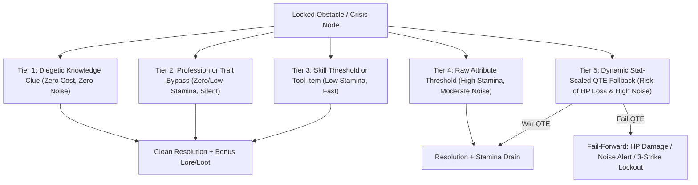
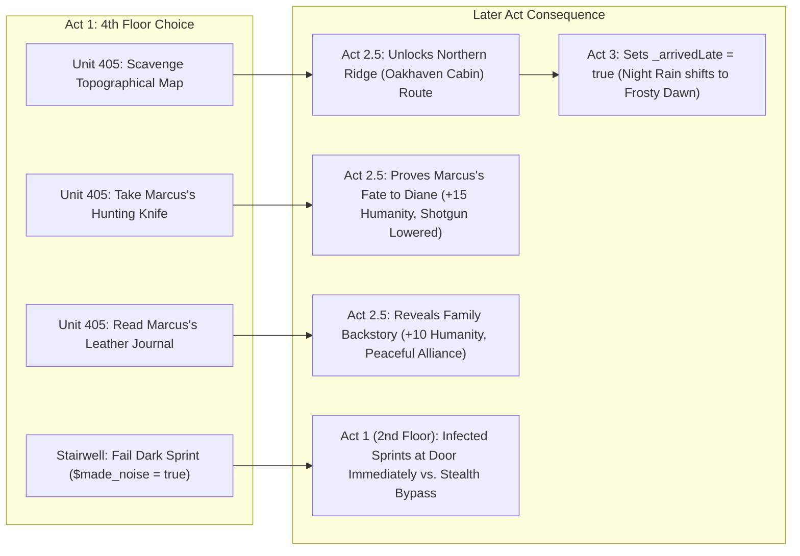

# 02. Technical Narrative & Branching Systems

> **[⬅️ Previous: Narrative Bible & Plot Summary](01-Narrative-Bible-and-Plot-Summary.md)** | **[🏠 Portfolio Home](Home.md)** | **[Next: Characters, Companions & Factions ➡️](03-Characters-Companions-and-Factions.md)**

---

## ⚙️ Core Technical Narrative Philosophy

In **Sunday's Last Breath**, narrative and systems design are inseparable. Rather than treating branching dialogue as isolated flavour text, every choice is wired into a persistent state machine that tracks **Time (`$time`)**, **Humanity (`$hum`)**, **Acoustic Stealth (`$made_noise`)**, **Diegetic Knowledge Flags**, and **Vehicle Seat Capacity (`_carCount`)**.

---

## 🔓 1. The 5-Tier Obstacle Resolution Architecture

A recurring flaw in traditional RPGs is the binary skill check: either you have `Lockpick 50` and pass, or you don't and the content is locked forever. In *Sunday's Last Breath*, every major physical or social obstacle is designed around a **5-Tier Resolution Pyramid** ("No Dead Ends, Always a Price"):



### Concrete Implementation Matrix Across the Game

| Obstacle / Scene | Tier 1: Diegetic Clue | Tier 2: Profession / Trait | Tier 3: Skill / Tool | Tier 4: Raw Stat | Tier 5: Fallback / Fail-Forward |
| :--- | :--- | :--- | :--- | :--- | :--- |
| **Unit 408 Keypad** ([`Unit_408.twee`](file:///D:/Documents/Twine/Twine%20Game/Sunday-Last-Breath/src/passages/Unit_408.twee)) | Enter `8445` (Read SMS in `Prologue_Phone`) | `Burglar` / `LOCKSMITH` | `Tech >= 2` or `Multi-Tool` | `PER >= 6` (Spot finger oil smudges on `4, 5, 8`) | `STR` Brute Force or 3-Strike Keypad Lockout |
| **Unit 405 Shotgun Trap** ([`Unit_405.twee`](file:///D:/Documents/Twine/Twine%20Game/Sunday-Last-Breath/src/passages/Unit_405.twee)) | — | `Burglar` / `LOCKSMITH` | `Tech >= 2` or `Multi-Tool` | `PER >= 6` (Trace monofilament wire) | Dynamic QTE where `Speed = 2.5 + (6 - $per) * 0.8` |
| **Unit 401 300-lb Shelf** ([`Unit_401.twee`](file:///D:/Documents/Twine/Twine%20Game/Sunday-Last-Breath/src/passages/Unit_401.twee)) | — | `Construction Worker` / `BREACHER` / `IRON GRIP` | `Tech >= 2` (Fulcrum leverage) or `Crowbar` / `Tire Iron` | `STR >= 6` (Deadlift shelf) | Dynamic `STR` QTE (`-10 HP` bruised ribs on fail) |
| **4th Floor Utility Door** ([`Utility_Closet.twee`](file:///D:/Documents/Twine/Twine%20Game/Sunday-Last-Breath/src/passages/Utility_Closet.twee)) | — | `Burglar` (Override cylinder) | `Tech >= 2` (Short mag-lock) or `Crowbar` | `STR >= 7` (Shoulder ram) | Dynamic `STR` QTE (`Target STR = 7`) |
| **Route 9 Gas Pump** ([`Act2_GasStation.twee`](file:///D:/Documents/Twine/Twine%20Game/Sunday-Last-Breath/src/passages/Act2_GasStation.twee)) | Enter `6821` (Found on receipt in dark store aisle) | `IT Specialist` | `Tech >= 2` (Bypass pump relay) | — | Siphon fuel manually (Time + Stamina + Ambush risk) |
| **Maya's Crashed Cruiser** ([`Act2_5_MayaCrash.twee`](file:///D:/Documents/Twine/Twine%20Game/Sunday-Last-Breath/src/passages/Act2_5_MayaCrash.twee)) | — | `HOTWIRE` (Cut battery cable to kill horn) | `Tech >= 2` or `Crowbar` or **Companion Vane** distraction | — | Brute Combat (`-10 Stamina`, fight turned cop first) |

### Mathematical QTE Scaling Formula
When a player lacks the required attribute or tool and resorts to physical desperation (Tier 5), the game does not use a static minigame. Instead, it calculates the **Attribute Deficit (`_statDiff`)** in real time:

```javascript
// Example from Unit_405.twee (Trap Disarm) & Utility_Closet.twee (Steel Door)
<<set _statDiff to (TargetStat - $playerStat)>>
<<set _qteSpeed to 2.2 + (_statDiff * 0.9)>>
<<set _qteWidth to 25 - (_statDiff * 4)>>
<<Minigame_QTE _qteSpeed _qteWidth>>
```
This ensures that a character with `STR 5` attempting a `STR 7` door experiences a tense but manageable timing window, whereas a character with `STR 2` faces a blistering needle speed and a razor-thin sweet spot.

---

## 🦋 2. Cross-Act Butterfly Effects ("Chekhov's Inventory")

Items and observational choices in Act 1 are designed to echo hours later in Act 2.5 and Act 3:



---

## 🧠 3. The Psychological Humanity System (`$hum`: 0–100)

Unlike standard morality meters that only unlock cosmetic endings, **Humanity (`$hum`)** in *Sunday's Last Breath* actively shapes **how the protagonist perceives the world** and **how they speak under pressure**.

### Three Psychological Brackets
1. **High Humanity (`$hum >= 70` — *The Empathetic Protector*):**
   - **Internal Monologue:** Focuses on human connection, guilt over those left behind, and the moral imperative to protect children (Lily, Diane's boys).
   - **Spoken Dialogue:** Warm, de-escalating, and reassuring.
2. **Mid Humanity (`$hum 31–69` — *The Pragmatic Survivor*):**
   - **Internal Monologue:** Weighs tactical risk (noise, ammo, time) against conscience.
   - **Spoken Dialogue:** Direct, guarded, and transactional without being needlessly cruel.
3. **Low Humanity (`$hum <= 30` — *The Ruthless Predator*):**
   - **Internal Monologue:** Cold, cynical, and Darwinian. Views terrified survivors as liabilities or leverage.
   - **Spoken Dialogue:** Intimidating, blunt, and coercive.

### Example: Dynamic Internal Monologue at the Police Crash (`Act2_5_MayaCrash.twee`)
| Humanity Bracket | Dynamic Internal Thought Rendered to Player |
| :--- | :--- |
| **`$hum >= 70`** | *"Maya. Lily. The faces from the lobby flash in your mind. The horn is blaring, drawing God-knows-what from the woods right to your position. Every survival instinct tells you to run, but you know you can't leave a child to die in the dark."* |
| **`$hum 31–69`** | *"You remember them from the barricade. It's a bad situation. That horn is a dinner bell for every infected lunatic out there. Getting involved means risking your own life, but standing here watching them get torn apart feels wrong."* |
| **`$hum <= 30`** | *"You warned her. She trusted the badge, and the badge drove them into a tree and tried to eat her. You have leverage now. It's a cruel new world, and doing charity work will only get you killed."* |

---

## 🚗 4. The 4-Seat Vehicle Capacity Economy (`_carCount`)

One of the game's signature systemic narrative mechanics is the **physical seat limit of the player's getaway sedan** in Act 3 ([`Act3_Sheriff.twee`](file:///D:/Documents/Twine/Twine%20Game/Sunday-Last-Breath/src/passages/Act3_Sheriff.twee) and [`Act3_Home.twee`](file:///D:/Documents/Twine/Twine%20Game/Sunday-Last-Breath/src/passages/Act3_Home.twee)):

```javascript
/* ── CAR CAPACITY CALCULATION ── */
<<set _carCount to 1>>                           /* Player (Driver) = 1 Seat */
<<if _hasVane>>  <<set _carCount += 1>><</if>>   /* Vane = +1 Seat */
<<if _hasMaya>>  <<set _carCount += 2>><</if>>   /* Maya + 7yo Lily = +2 Seats */
<<if _hasDiane>> <<set _carCount += 3>><</if>>   /* Diane + 2 Boys = +3 Seats */
<<set _carFull to (_carCount >= 4)>>
```

- **Why This Matters Narrative-Wise:**
  - In most RPGs, recruited companions vanish into an infinite "camp" inventory.
  - In *Sunday's Last Breath*, every survivor you pull into your sedan occupies physical space, reacts to your equipped weapon (`_isGun`, `_isBlade`, `_isBlunt`), and converses with other passengers in the backseat (e.g., Vane & Maya vs. Vane & Diane in [`Act3_Home.twee`](file:///D:/Documents/Twine/Twine%20Game/Sunday-Last-Breath/src/passages/Act3_Home.twee)).
  - When the player meets **Officer Reyes** at Sheriff Substation 4, the script checks `_carFull`. If the player is already carrying Vane and Maya/Lily (`_carCount == 4`) or Diane's family (`_carCount >= 4`), the sedan cannot fit another adult passenger, forcing a different tactical arrangement for the journey to Timberline Regional High School.

---

## 🌅 5. Chronological & Atmospheric State Reactivity (`_arrivedLate`)

Visiting **Oakhaven Cabin** in Act 2.5 sets the boolean state `_arrivedLate = visited("Act2_5_MarcusCabin")`. In Act 3, this single variable transforms the entire presentation and economy of the **Colonial House (`Act3_Home.twee`)** and **Sheriff Substation (`Act3_Sheriff.twee`)**:

| Feature / Zone | On-Time Arrival (`_arrivedLate == false` — 04:00 Night) | Late Arrival (`_arrivedLate == true` — 06:00+ Dawn) |
| :--- | :--- | :--- |
| **Visual Asset** | `suburban_house_night.gif` (Pitch black, pouring rain) | `suburban_house_morning.gif` (Pale gray dawn mist, frost) |
| **Window Candle** | Burning brightly behind the dark blanket; someone is actively awake holding the dark at bay. | Burned down into a cold, unusable puddle of wax; yields **no Lighter**. |
| **PER 5 / Tracker Clue** | Fresh wet mud bicycle tracks; warm smell of freshly brewed coffee drifting under the door. | Dew-covered cold tire tracks; stale smell of cold coffee grounds from the utility pipe. |
| **Kitchen & Medicine Loot** | **2× Canned Food, 2× Water, 2× Painkillers** (House was just vacated minutes ago). | **1× Canned Food, 1× Water, 1× Painkillers** (Scavengers already cleared the front shelves hours ago). |
| **Companion Banter** | Maya pleads to get Lily inside out of the freezing midnight rain; Vane worries an occupant is holding an angle in the dark. | Maya warns that the lifting morning mist exposes their car on the curb; Vane deduces the occupants passed out or fled hours ago. |
