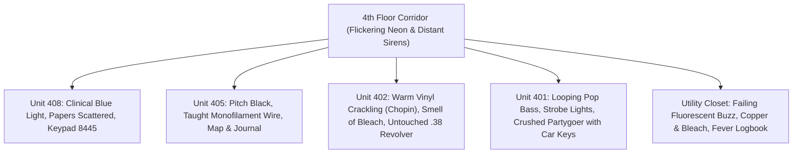

# 04. Diegetic UI & Environmental Storytelling

> **[⬅️ Previous: Characters, Companions & Factions](03-Characters-Companions-and-Factions.md)** | **[🏠 Portfolio Home](Home.md)** | **[Next: Selected Writing Samples ➡️](05-Selected-Writing-Samples.md)**

---

## 📱 Why Diegetic Storytelling Matters in *Sunday's Last Breath*

A core design pillar of **Sunday's Last Breath**—inspired by found-interface thrillers like *Simulacra* and *Sara Is Missing* alongside survival RPGs—is that **exposition should never feel like a textbook**. Players discover the nature of the outbreak, the collapse of civil order, and the codes needed to survive by interacting with **diegetic media**: cracked smartphones, frequency scanners, encrypted command-line terminals, maintenance logbooks, and thermal receipts.

---

## 📲 1. The Cracked Smartphone Feed (`Prologue_Phone.twee`)

In the opening 15 minutes ([`Prologue_Phone.twee`](file:///D:/Documents/Twine/Twine%20Game/Sunday-Last-Breath/src/passages/Prologue_Phone.twee)), the player unlocks their smartphone to find cellular networks failing (`1 Bar / Roaming`). The UI presents two diegetic layers:

### Layer A: Live Social Feed (`#SeattleLockdown`)
The feed contrasts **institutional denial** against **raw citizen panic**:
1. **`@CityScanner_WA` (Official Municipal Account):** Attempts to calm the public by claiming the downtown sirens and power outages are due to a "major water main break and transformer fire near 4th & Pine."
2. **`@NewsWire_Alerts`:** Reports that Harborview Medical Center has gone on total lockdown after "multiple violent assaults in the triage wing."
3. **`@anon_9921` (Found-Footage Video Post):** A shaky 8-second video filmed from a second-story window showing a Riot Police line getting overrun by sprinting, unarmored civilians who ignore beanbag rounds and tear gas.

### Layer B: Personal SMS Thread (Actionable Puzzle Clue)
Buried beneath the public chaos is a direct text message from **Professor Arthur Harmon (Unit 408)**:
> **`[23:42] Prof. Harmon (408):`** *"If you're still in the building, DO NOT go down to the street. The police at the corner aren't evacuating anyone, they're containing us. If I don't make it back to 408, my door code is **8445**. Take the research notes on my desk and get out of Seattle before dawn."*

**Design Payoff:**
- Players who take 5 minutes to check their phone in the Prologue unlock a **zero-stamina, zero-noise bypass** on the electronic keypad in [`Unit_408.twee`](file:///D:/Documents/Twine/Twine%20Game/Sunday-Last-Breath/src/passages/Unit_408.twee).
- Furthermore, seeing the disinformation war on social media sets up the tragic punchline in **Unit 402**, where the elderly Andersons died because they believed a fake social media post about nerve gas.

---

## 📻 2. Analog Police Scanner Intercept (`Prologue_Radio.twee`)

Tuning the bedside emergency radio to **`FREQ: 154.790 MHz`** ([`Prologue_Radio.twee`](file:///D:/Documents/Twine/Twine%20Game/Sunday-Last-Breath/src/passages/Prologue_Radio.twee)) delivers an audio-visual transcript of Seattle PD's collapse:
- **Narrative Economy:** In less than 250 words, the radio intercept establishes:
  1. **Biological Mechanics:** Sedatives, tasers, and body-shots do not stop the infected (`UNIT 4-CHARLIE` reporting a suspect with two rounds in the chest still tearing through a cruiser partition).
  2. **Collapse of Law:** `DISPATCH` revokes standard policing protocols across King County: *"All units, rules of engagement are hereby suspended. Lethal force is authorized. Aim for the head."*
  3. **Foreshadowing Act 1 & Act 2.5:** This broadcast directly foreshadows why the police barricade outside the Ascott Lobby is so lethal—and why Maya's decision to trust the rookie cop leads to the horrifying cruiser crash in `Act2_5_MayaCrash`.

---

## 💻 3. Encrypted Military Terminal (`Prologue_Hacking.twee`)

For tech-oriented builds (`IT Specialist` or `Tech >= 1`), the laptop in Unit 404 ([`Prologue_Hacking.twee`](file:///D:/Documents/Twine/Twine%20Game/Sunday-Last-Breath/src/passages/Prologue_Hacking.twee)) simulates a command-line packet injection into **`SYS_ADMIN - SECURE_NODE_04`**:

```text
========================================================
>> CONNECTION ESTABLISHED: DOD_NORTHCOM_NODE_04
>> DECRYPTING DIRECTIVE: OPR_WILDFIRE_FINAL.ENC
========================================================
CLASSIFICATION: TOP SECRET // NOFORN
SUBJECT: SECTOR 4 (SEATTLE METRO) CONTAINMENT FAILURE

1. PATHOGEN PROJECTION: 87.4% URBAN SATURATION BY 0400 HRS.
2. QUARANTINE PERIMETER: ALL I-5 AND I-90 BRIDGES SEALED.
3. DIRECTIVE: INITIATE TOTAL THERMAL STERILIZATION (FIREBOMBING)
   OF SECTOR 4 AT 0600 HOURS SHARP. NO EVACUATION EXTENSIONS.
========================================================
[DOWNLOADING TIER-1 CLEARANCE PASSKEY... 100%]
```

**Design Payoff:**
- Establishes the **macro ticking clock** of the entire game (**06:00 hours**).
- Explains why arriving late in Act 3 (`_arrivedLate = true` after Dawn) carries such an eerie, post-apocalyptic silence—the city behind the player has just been incinerated.

---

## 🚪 4. Environmental Contrasts: The Four Apartments of Floor 4

Rather than populating the 4th floor with generic loot containers, each apartment in Act 1 uses **sensory contrast (audio, smell, lighting, and corpse arrangement)** to tell a self-contained story:



### Case Study: Unit 402 ("The Quiet Room") vs. Unit 401 ("The Party That Ended")
- **Unit 402 ([`Unit_402.twee`](file:///D:/Documents/Twine/Twine%20Game/Sunday-Last-Breath/src/passages/Unit_402.twee)):**
  - **Audio:** Chopin's *Nocturne in E-flat major, Op. 9, No. 2* spinning softly on a vintage record player.
  - **Smell:** Pungent chemical bleach, masking no violence—only quiet despair.
  - **Visual:** An elderly couple holding hands on the sofa, two empty glasses on the coffee table beside a printed internet forum post warning of "imminent military nerve gas."
  - **Mechanical Integration:** On the side table rests a pristine **`.38 Revolver`**. Mr. Anderson couldn't bring himself to shoot his wife, choosing poison instead. The player gains one of the best early-game firearms without a fight, but must absorb the emotional weight of the room.
- **Unit 401 ([`Unit_401.twee`](file:///D:/Documents/Twine/Twine%20Game/Sunday-Last-Breath/src/passages/Unit_401.twee)):**
  - **Audio:** Muffled, upbeat electronic pop music looping endlessly from a knocked-over speaker.
  - **Visual:** Red plastic cups, spilled liquor, and a frantic brawl that brought a 300-lb oak bookcase crashing down onto a guest who was trying to flee with his **Sedan Keys**.
  - **Juxtaposition:** Stepping directly from the solemn, classical tragedy of Unit 402 into the chaotic, bass-thumping carnage of Unit 401 creates immediate tonal whiplash that keeps the player psychologically off-balance.
