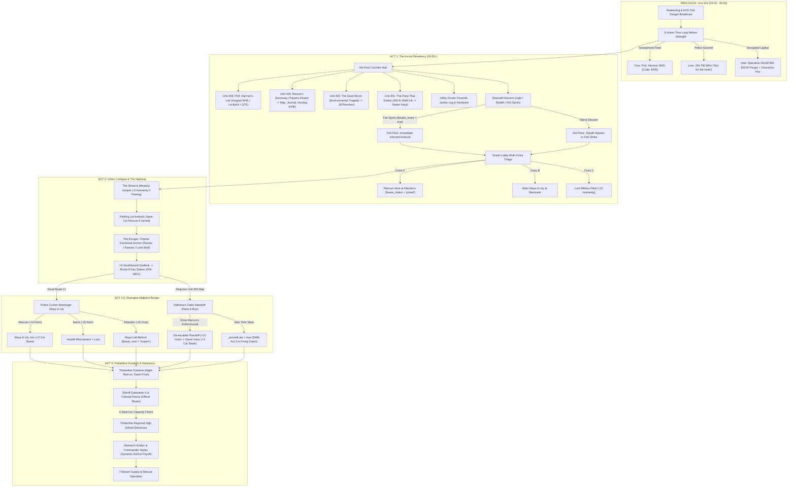

# 🩸 Sunday's Last Breath — Narrative & Systems Design Wiki

> **Portfolio Showcase:** Technical Narrative Design, Interactive Branching Architecture, & Diegetic Storytelling  
> **Author / Designer:** Elang Esa (Neal Sage) Yudhistira — *Technical Narrative Designer | Game Writer & Systems Designer*  
> **Engine & Implementation:** Twine (SugarCube 2 / JavaScript) & Unity (C# Hybrid 2.5D Survival RPG)  
> **Genre:** Post-Apocalyptic Psychological Survival RPG / Interactive Thriller  

---

## 🎯 Executive Summary (For Reviewers & Studios)

**Sunday's Last Breath** is an interactive survival thriller set during the first 12 hours of a catastrophic neuro-pathogen outbreak in King County, Washington. Beginning at **23:45 on Saturday, October 25, 2025**, the player must escape a locked-down urban apartment complex, navigate the collapse of civil authority, manage a shrinking four-seat vehicle economy, and reach the rural sanctuary of Timberline before **Operation WILDFIRE** initiates a military firebombing purge at **06:00 hours**.

This Wiki serves as both the **complete narrative & systems documentation** extracted from the playable Twine prototype and a **Technical Narrative Design portfolio** demonstrating:

1. **Diegetic Media & Found-Interface Storytelling:** Delivering critical worldbuilding, tonal dread, and actionable puzzle clues through cracked smartphone social feeds (`#SeattleLockdown`), analog police scanner intercepts (`154.790 MHz`), encrypted military terminals (`SYS_ADMIN - SECURE_NODE_04`), and crumpled thermal receipts.
2. **Multi-Layered Choice Architecture ("No Dead Ends, Always a Price"):** Every major obstacle supports 4–5 distinct resolution vectors—**Hard Knowledge Clues**, **Profession/Trait Bypasses**, **Skill/Tool Checks**, **Raw Stat Thresholds**, or **Stat-Scaled Quick-Time Events (QTEs)**—ensuring player builds always feel validated while failures push the story forward with tangible physical or acoustic consequences.
3. **Long-Range State Persistence & Butterfly Effects:** Small observational choices in Act 1 (such as reading a text message before midnight, failing a stealth check in a stairwell, or scavenging a dead survivalist's journal and hunting knife) directly alter combat states, companion survival, and high-stakes armed negotiations two acts later.
4. **Psychological Morality (`Humanity 0–100`):** Rather than binary "Paragon/Renegade" meters, the player's **Humanity (`$hum`)** dynamically rewrites both **internal monologue** and **available spoken dialogue** across three psychological brackets (*Empathetic*, *Pragmatic*, and *Ruthless/Predatory*).
5. **Chronological & Atmospheric Reactivity:** Taking optional mid-game detours advances the global clock past dawn (`_arrivedLate`), dynamically transforming Act 3's lighting, weather, sensory descriptions (warm coffee and burning candles vs. cold grounds and pooled wax), NPC alertness, and remaining scavenging yields.

---

## 🗂️ Wiki Navigation & Portfolio Index

| Document | Focus Area | Key Highlights for Reviewers |
| :--- | :--- | :--- |
| **[01. Narrative Bible & Plot Summary](01-Narrative-Bible-and-Plot-Summary.md)** | Macro Story Structure & Act-by-Act Synopsis | Complete narrative extraction from Prologue to Act 3, covering all locations, plot twists, and divergent midpoint routes. |
| **[02. Technical Narrative & Branching Systems](02-Technical-Narrative-and-Branching-Systems.md)** | Systems Design, State Tracking & Flowcharts | Mermaid state diagrams, the 5-Tier Obstacle Philosophy, Humanity (`$hum`) dialogue matrices, and the 4-Seat Vehicle Triage economy. |
| **[03. Characters, Companions & Factions](03-Characters-Companions-and-Factions.md)** | Character Bible & Relationship Arcs | Psychological profiles, trust variables, and reactive arcs for **Vane**, **Maya & Lily**, **Diane & Marcus**, **Officer Reyes**, and **Matriarch Evelyn**. |
| **[04. Diegetic UI & Environmental Storytelling](04-Diegetic-UI-and-Environmental-Storytelling.md)** | In-World Media, Found Footage & Micro-Stories | Deep dive into smartphone feeds, radio transcripts, terminal hacking, and environmental storytelling in the Ascott Residency. |
| **[05. Selected Writing Samples](05-Selected-Writing-Samples.md)** | Curated Script & Prose Excerpts | Clean, formatted script samples showcasing diegetic UI writing, environmental tragedy, multi-crisis triage, and morality-gated standoffs. |

---

## 🗺️ Macro Narrative Architecture

The following diagram illustrates the high-level flow of **Sunday's Last Breath**, highlighting how clues, items, and time expenditures in early acts cascade into later chapters:

---

## 🛠️ Core Narrative Design Pillars

### 1. Diegetic Information Architecture
Instead of exposition dumps, players piece together the collapse of Seattle through **in-universe artifacts**:
- **Social Media Disinformation vs. Ground Truth:** In [`Prologue_Phone.twee`](file:///D:/Documents/Twine/Twine%20Game/Sunday-Last-Breath/src/passages/Prologue_Phone.twee), the player scrolls a live social feed where official city accounts claim a "water main break," citizen journalists post chaotic street videos, and a terrified neighbor (Professor Harmon) texts a 4-digit apartment code (`8445`). Meanwhile, in [`Unit_402.twee`](file:///D:/Documents/Twine/Twine%20Game/Sunday-Last-Breath/src/passages/Unit_402.twee), the player discovers an elderly couple who committed suicide with bleach after believing a fake internet rumor about military nerve gas.
- **Actionable Diegetic Clues:** Pin codes (`8445`, `6821`), topographical coordinates (*Oakhaven Cabin*), and personal heirlooms (*Marcus's Hunting Knife*) are never arbitrary key-items—they carry emotional weight and narrative context.

### 2. S.P.A.I.C. & Multi-Modal Obstacle Resolution
Characters are defined by **Profession** (*Police Officer, Doctor, Burglar, Construction Worker, Mechanic, IT Specialist*), **Core Attributes** (*Strength, Perception, Agility, Intellect, Charisma*), **Skills**, and **Psychological/Physical Traits** (*Paranoid, Locksmith, Field Medic, Tracker, Breacher, Iron Grip*).
- Every locked door, booby trap, or crisis checks the player's full sheet before falling back to a **dynamically scaled QTE minigame** where the speed and target window mathematically reflect the gap between the player's stat and the obstacle's difficulty.

### 3. Scarcity of Space & Empathy
Survival is not just about hit points and ammo—it is about **who fits in the getaway car** and **what happens to your psyche when you shut the door on someone else**.
- The player's four-seat sedan creates an organic mid-to-late game triage problem: rescuing **Vane** (1 seat), **Maya & Lily** (2 seats), or **Diane & her two sons** (3 seats) directly determines whether the player has room to extract **Officer Reyes** in Act 3 or must coordinate an external rendezvous.
